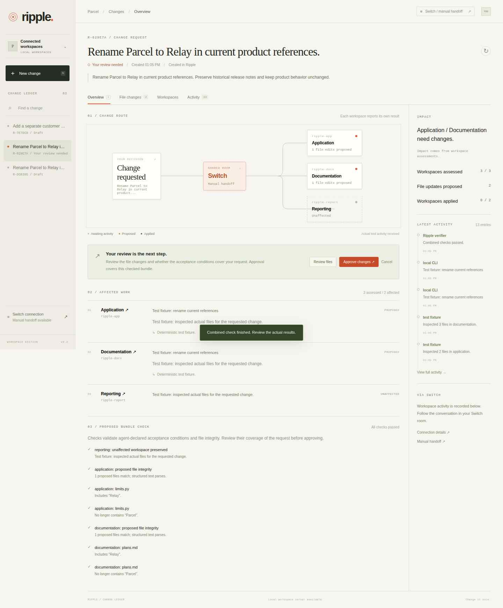

# Ripple

Updated: 2026-11-08

**Change it once. Update everything affected.**

[](https://github.com/abhishek1846/ripple-switch/actions/workflows/checks.yml)
[MIT license](LICENSE) · [Agent workflow](agents/WORKFLOW.md) · [Switch example setup](switch/SETUP.md)

Ripple coordinates reviewed edits across a company's project workspaces. Each workspace is inspected for impact. Agents propose changes and acceptance checks. A person reviews the diffs before approving application.

You choose the workspaces and the agents. There is no fixed agent count or required set of departments. Several agents can collaborate on one workspace, and one agent can work across several workspaces. CLI agents can use Ripple directly. Switch adds optional chat coordination.

The included Parcel project shows one configuration with application, documentation, and reporting agents. A request could be:

```text
When someone selects too many files, add this guidance to the error:
"Remove some files or upgrade your plan."
Add a short troubleshooting guide and link it from onboarding.
Keep limits and forecasts unchanged.
```

The application and documentation workspaces can need edits while reporting stays unchanged. Other requests and configurations can involve a different set of participants.

<details>
<summary>See the example review dashboard</summary>



This screenshot uses deterministic browser test proposals. It illustrates the included example, not a recorded Switch-agent run.

</details>

## Open the included example

Ripple uses Python 3.9+ on macOS or Linux with no pip dependencies. Native Windows is not supported.

```bash
git clone https://github.com/abhishek1846/ripple-switch.git
cd ripple-switch
python3 ripple.py serve
```

Open **http://127.0.0.1:8790** and keep the Terminal running. Use `--port 8791` if that port is busy. Starting the dashboard does not launch agents.

Create a change in the dashboard. Give its ID to your CLI agents using the [workflow guide](agents/WORKFLOW.md), or connect the supplied agents through [Switch setup](switch/SETUP.md). In that example room, mention `@ripple` with your request.

Agents inspect and assess every workspace as **affected**, **unaffected**, or **blocked**, with a reason. Only affected workspaces need proposals. After combined checks pass, review **File changes**, check acceptance coverage, and approve. Agents then apply the reviewed proposals. The last affected workspace application verifies a fresh snapshot of the updated files.

**Verified** means the recorded checks pass. Those checks still need to cover the intended request. Message delivery alone is not completed work.

## Use your own project

Run Ripple from your project's directory. Replace `/path/to/ripple` with the absolute source checkout path:

```bash
cd /path/to/my-project
python3 /path/to/ripple/ripple.py init
```

This creates a starter `ripple.json` without overwriting an existing file. It starts with one workspace for your project directory and an empty agent roster. Edit it to describe your organization, for example:

```json
{
  "name": "my-product",
  "workspaces": {
    "backend": {
      "path": "services/api",
      "title": "Backend API",
      "description": "API behavior and configuration",
      "protected": ["migrations/**"]
    },
    "frontend": {
      "path": "apps/web",
      "title": "Web client",
      "protected": ["public/vendor/**"]
    },
    "docs": {
      "path": "docs",
      "title": "Developer guides",
      "protected": ["archive/**"]
    }
  },
  "agents": {
    "delivery-lead": {"workspaces": []},
    "api-engineer": {"workspaces": ["backend"]},
    "web-engineer": {"workspaces": ["frontend", "docs"]},
    "technical-writer": {"workspaces": ["docs"]}
  },
  "coordinator": "delivery-lead"
}
```

This example has four agents and three workspaces. Add or remove agents and workspaces to match your organization.

- Workspace `path` selects an existing directory relative to your project root. Paths must stay inside the project and must not overlap. `.` can represent the whole project as one workspace.
- Workspace `title` and `description` describe its purpose. `protected` lists glob patterns that proposals cannot target.
- Agent keys identify your agents. `workspaces` lists their responsibilities. An optional `title` sets a display name, and `instructions` can point to a role file inside your project.
- `coordinator` optionally names an agent that receives Switch intake handoffs. It can have no workspace assignment.

The roster describes participants; it does not register or launch them. For Switch, match those names to agents in your actual room. For direct CLI use, roster entries and Switch are optional. Actor labels record the caller's identity claim and do not authenticate it.

Start the dashboard from the same project directory:

```bash
python3 /path/to/ripple/ripple.py serve
```

Commands default to the current directory. To operate from elsewhere, pass `--root /absolute/project/path` before the command. The included Switch template is for the Parcel example; adapt its agents and instructions to your company's configuration.

## Coordinate CLI agents

Create a request:

```bash
python3 /path/to/ripple/ripple.py start --request "Update API token expiry and its documentation."
```

Use the returned change ID in subsequent commands. Give each participating agent its workspace names and any role instructions. Agents sharing a workspace coordinate one current proposal; another submission revises that proposal and invalidates prior checks and approval.

| Command | Purpose |
| --- | --- |
| `inspect ID AREA --actor NAME` | Read the request and workspace files with their hashes. |
| `assess ID AREA --outcome affected --reason "..." --actor NAME` | Record impact. Outcomes also include `unaffected` and `blocked`. |
| `clarify ID --answer "..."` | Record the human's answer before reassessment. |
| `propose ID AREA --patch FILE --summary "..." --actor NAME` | Submit resulting file contents and acceptance conditions. |
| `check ID` | Check the combined proposals before review. |
| `apply ID AREA --actor NAME` | Apply that workspace's approved proposal. |
| `status` | Read project configuration, changes, and activity. |

Prefix each command with `python3 /path/to/ripple/ripple.py`. Approval is performed by the person in the dashboard. The [workflow guide](agents/WORKFLOW.md) specifies proposal JSON and acceptance conditions.

## Optional Switch coordination

Configure your company agents in Switch with their actual working directories, providers, instructions, and addressing permissions. Keep their roster entries and workspace assignments consistent with `ripple.json`. Ripple's request and approval handoffs use that configuration.

You can copy **Manual handoff** into your room. To send from the dashboard, configure [direct dispatch](switch/DIRECT-DISPATCH.md). A configured coordinator receives the intake request. Without one, the message lists workspace assignments so participants can coordinate the request.

The supplied [setup guide](switch/SETUP.md) and [template](switch/ripple.template.yaml) illustrate the three-agent Parcel example. They do not define a product limit.

## Checks and recovery

Existing-file proposals must match their inspected SHA256 hashes. Outside edits block approval or application. Revisions revoke approval. Workspace configuration is bound to new requests so a reviewed proposal cannot silently be redirected to a different folder.

Acceptance conditions support `contains`, `not_contains`, `json_equals`, and `csv_equals`. Ripple also parses changed Python, JSON, and CSV files. It does not prove that agent-declared conditions fully describe a request or replace your project's test suite.

Ripple can add or edit supported text files, including Python, JavaScript, TypeScript, Markdown, JSON, CSV, HTML, CSS, YAML, TOML, SQL, and shell files. Binary assets and file deletion are not supported. External SaaS connectors are not included. Hidden files and generated dependency/build directories are excluded from inspection. `ripple.json` is control configuration and cannot be edited through a workspace proposal.

File replacements are atomic. A journal supports recovery of an interrupted area's uncommitted writes on the next CLI or dashboard operation. Completed areas remain applied. Conflicting outside edits stop recovery for reconciliation. The overall request is not a transaction across all workspaces. Preserve `.ripple/` when resolving an error.

Agent roles are instructions, not operating-system isolation. The dashboard is intended for a trusted local user. State and dispatch credentials stay in ignored `.ripple/`. Restart the server after backend updates and refresh your browser.

## Development checks

```bash
python3 -m unittest discover -s tests -v
node --check web/app.js
node --check tests/browser.mjs
node tests/ui_state.mjs
```

The tests use isolated projects. They cover the included example, company-defined workspace names, different agent counts, shared responsibilities, approval boundaries, and process interruption recovery.

Optional browser verification requires Node and Playwright:

```bash
npm install --ignore-scripts --no-audit --no-fund
npx playwright install chromium
npm run test:browser
```

Browser checks use isolated working files and an independent server port. Their proposals are deterministic fixtures. Verify an actual Switch conversation and completed application separately before claiming a native agent demonstration.

## License

[MIT](LICENSE)
